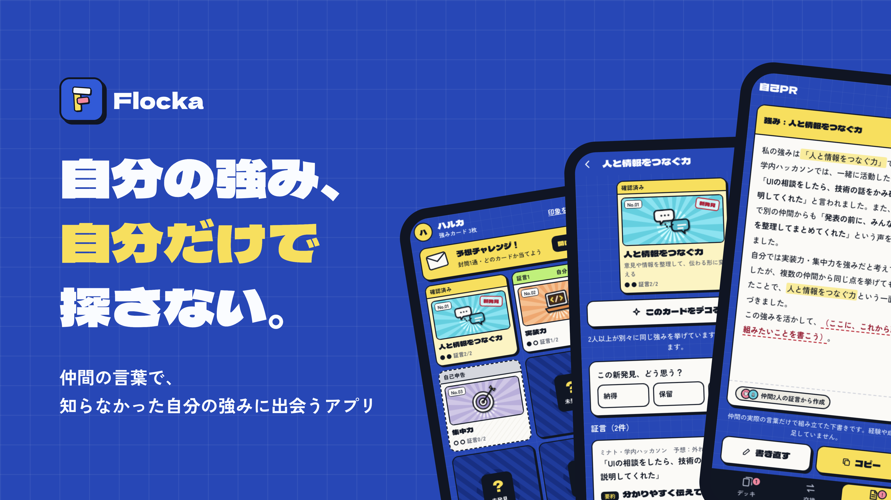
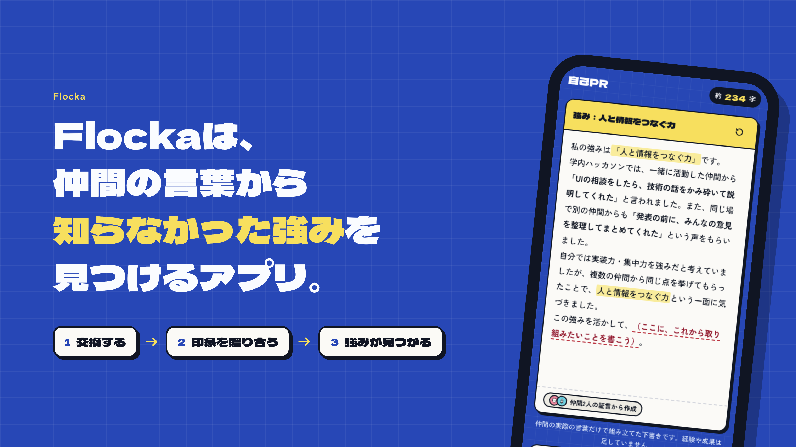
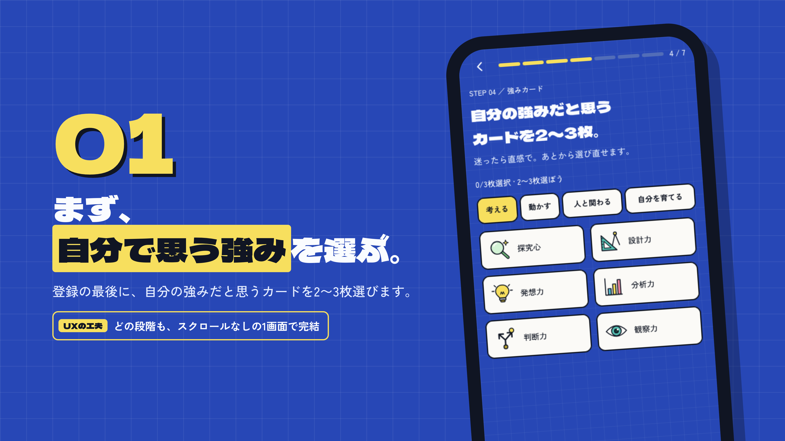
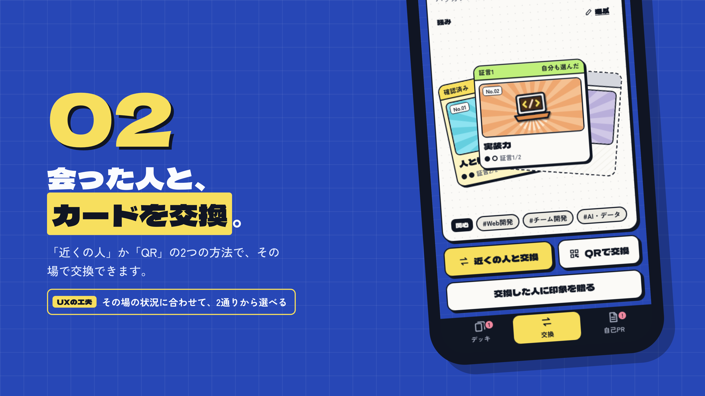
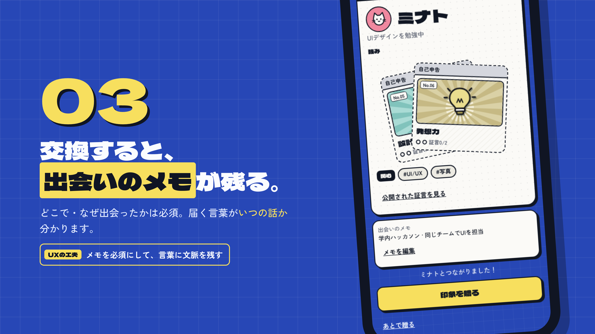
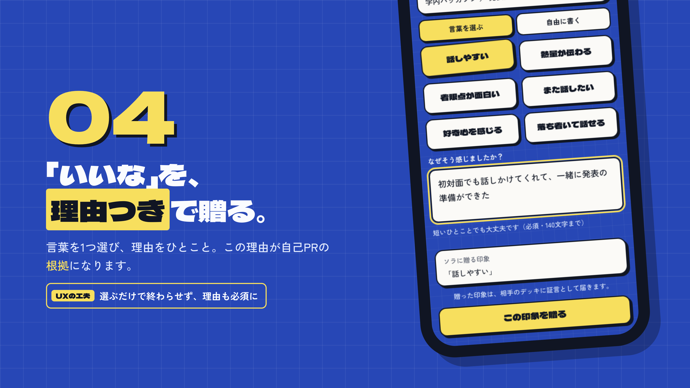
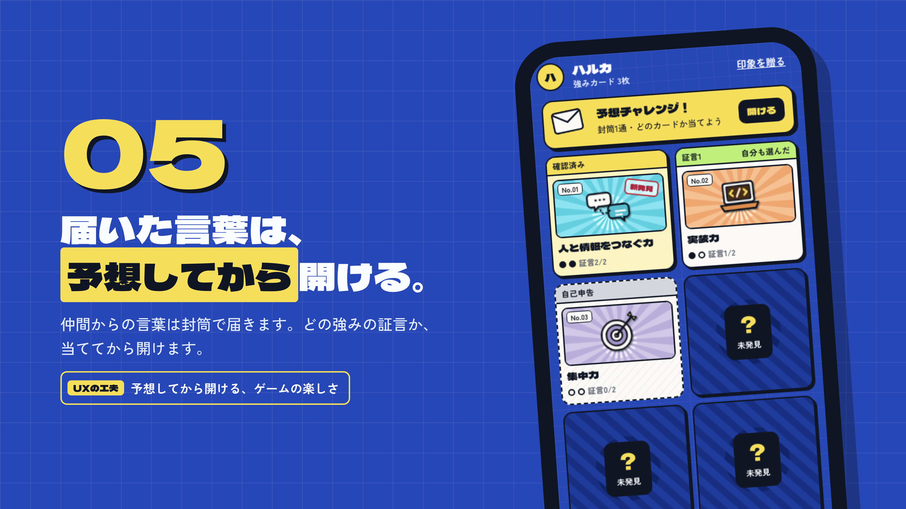
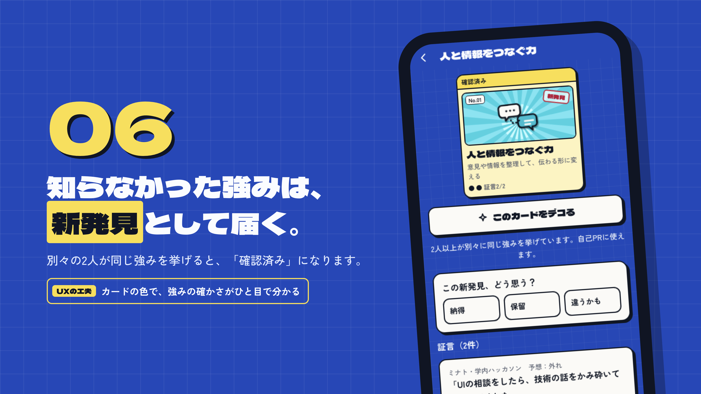
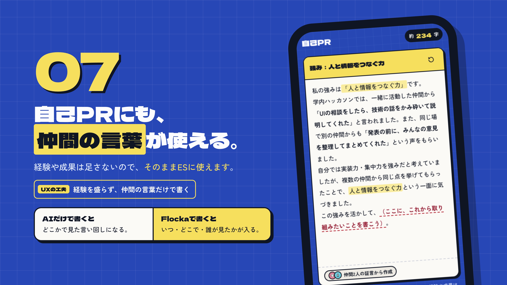
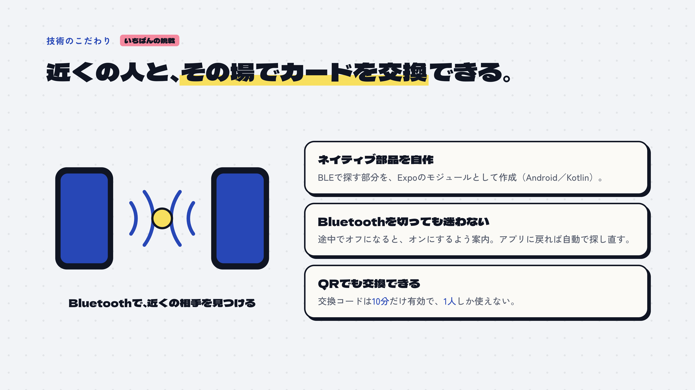

# Flocka

  

   
   

  <strong>仲間の言葉で、知らなかった自分の強みに出会うアプリ。</strong>

   
   

  
  
  
  
  

## Flockaとは

Flockaは、自分では気づけなかった強みを、実際に一緒に過ごした仲間の言葉から見つけるアプリです。

自己分析やAIだけで自己PRを作ると、材料になるのは自分で思いついた強みだけになりがちです。Flockaでは、仲間が実際に見た行動と、そのときの状況を「証言」として集めます。自分の思い込みではなく、周りの人が見つけた具体的なエピソードを、強みと自己PRの根拠にします。

  

## 体験の流れ

### 01 — 自分で思う強みを選ぶ

登録の最後に、まず自分が強みだと思うカードを選びます。

  

### 02 — 会った人とカードを交換する

Bluetoothで近くの人を見つけるか、QRコードを使ってその場で交換します。

  

### 03 — 出会いのメモを残す

どこで、なぜ出会ったのかを記録し、あとから届く言葉に文脈を残します。

  

### 04 — 印象を理由つきで贈る

相手の強みを表す言葉を選び、実際に見た行動やエピソードを添えます。

  

### 05 — 予想してから言葉を開ける

届いた言葉は封筒で届きます。どの強みを見つけてもらえたか予想してから開く、ゲームのような体験です。

  

### 06 — 知らなかった強みを発見する

別々の2人以上が同じ強みを挙げると「確認済み」になり、自分だけでは選ばなかった強みが新発見として残ります。

  

### 07 — 仲間の言葉から自己PRを作る

証言に含まれる具体的な言葉を根拠に、自己PRの下書きを組み立てます。

  

## AIに、作り話はさせない

FlockaのAIは、強みや経験をゼロから考える役ではありません。材料は、本人へ実際に届いた仲間の証言だけです。

- サーバーが、本人に届いた証言と確認済みの強みをD1から読み込む
- Workers AIが、各文に根拠となる証言番号と原文引用を付けた自己PRをJSONで返す
- ZodでJSONの形式を検証し、全体で別々の証言を2件以上使っているかを確認する
- サーバーが各文の引用・数字・内容語を、指定された証言の原文と照合する
- Clefが各文について、指定された証言で内容全体を裏づけられる確率を判定する
- 根拠を示せない文が1つでもあるAI出力は、自己PRとして返さない

文章を整えても、誰が・いつ・どこで見た強みなのかという根拠は消しません。

## 近くの人と、その場で交換

  

近距離交換はBluetooth LEのネイティブモジュールで実装しています。Bluetoothが途中でオフになった場合は再設定を案内し、アプリへ戻ると自動で探索を再開します。Bluetoothを使えない場面では、10分間・1人だけが使えるQR交換コードを利用できます。

## 技術構成

| カテゴリ | 技術 |
| --- | --- |
| モバイル |     |
| UI |    |
| 端末機能 |    |
| 通知 |     |
| 認証・メール |    |
| 交換 |     |
| API・データ |      |
| AI |     |
| ビルド |    |
