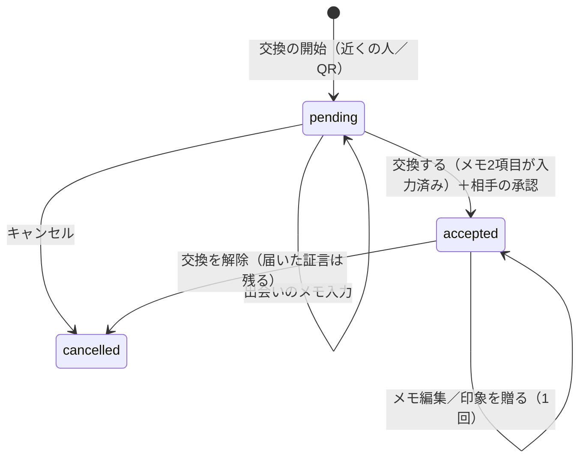
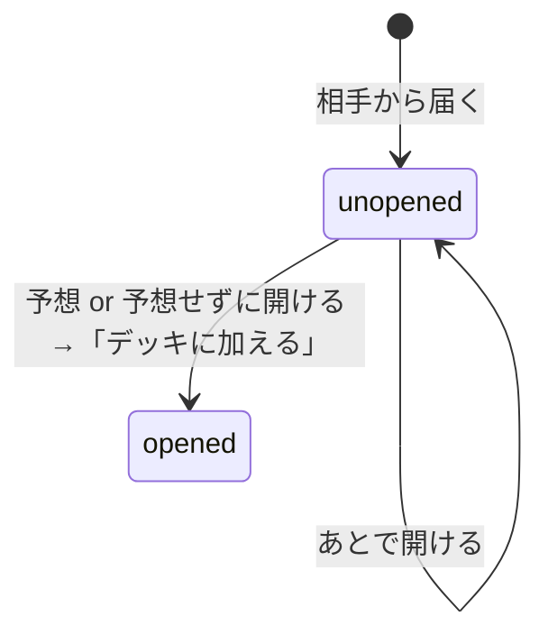
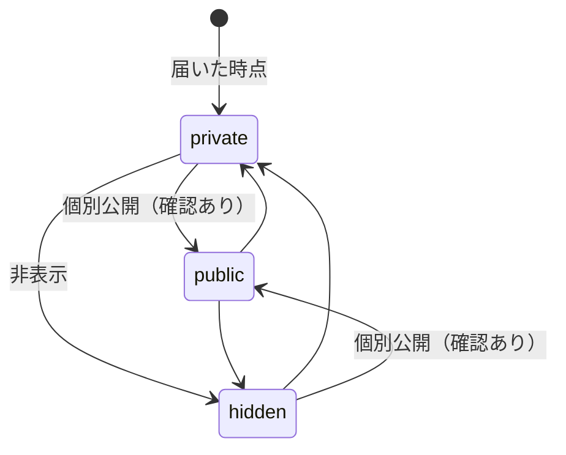
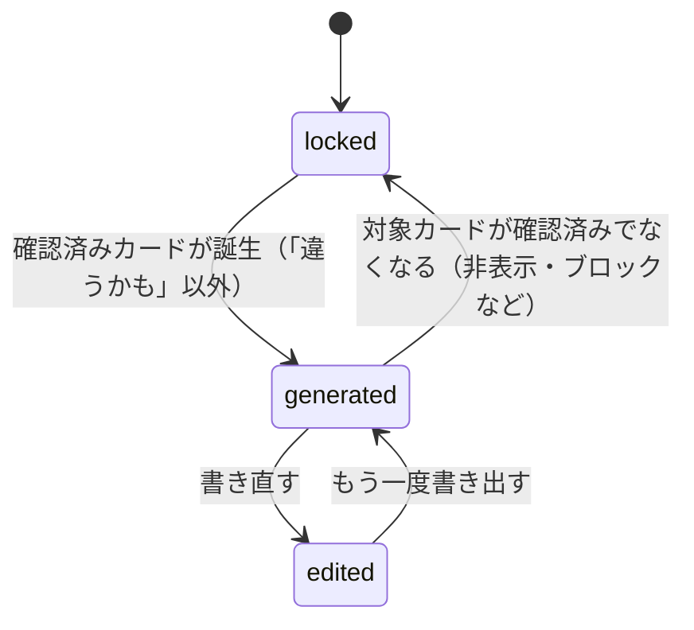
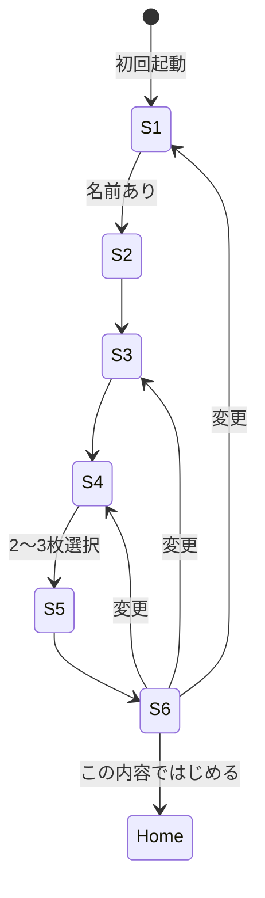

# Flocka v2 画面一覧・状態遷移 仕様書（本実装向け）

- 対象プロトタイプ：`flocka-v2-blue-prototype.html` / `flocka-v2-game.css`
- 作成日：2026-10-13
- 位置づけ：プロトタイプの挙動をそのまま本実装の仕様として書き起こしたもの。プロトタイプ固有のモック処理は「9. モック実装と本実装の差分」にまとめる。

---

## 1. プロダクト概要

仲間と「プレイヤーカード」を交換し、相手から届いた印象・場面のメモ（＝証言）を、開封前に「どの強みカードの証言か」予想してからデッキに加える。同じ強みに **2人以上** の証言がそろうと「確認済みカード」になり、その証言だけを使って自己PRの下書きが生成される。

---

## 2. ナビゲーション構造

### 2.1 タブ

| タブID | ラベル | ルート画面 | バッジ |
|---|---|---|---|
| `find` | デッキ | `deck` | 未開封の封筒数 |
| `exchange` | 交換 | `exchange` | なし |
| `pr` | 自己PR | `pr` | 自己PRが書ける状態のとき「!」 |

- タブごとに独立した画面スタックを持つ（iOS の UINavigationController 相当）。
- 選択中のタブをもう一度押すと、そのタブのスタックをルートに戻す。
- ナビゲーション状態（タブ＋各スタック）は永続化する。アプリを終了して起動し直したときはデッキ（`find` タブのルート）を開き、他のタブのスタックだけを復元する。スタック末尾の画面IDが存在しなければ初期状態に戻す。新規ログイン直後もデッキから始める。

### 2.2 タブバーを隠す画面（フォーカス画面）

`give` / `memo` / `scan` / `confirm` / `nearby` の5画面では、タブバーを表示しない。登録フロー中もタブバーは非表示。

### 2.3 ナビゲーション操作

| 操作 | 内容 |
|---|---|
| `push(id, params)` | 現在のタブのスタックに積む |
| `replace(id, params)` | スタック末尾を差し替える（交換開始 → 確認画面など） |
| `pop()` | 1つ戻る（ルートでは何もしない） |
| `popTo(id)` | 指定画面まで戻る |
| `goTab(tab, entry?)` | タブを切り替え、そのタブをルートに初期化し、必要なら1画面積む |
| `reset()` | 全タブを初期状態に戻す（登録完了時） |

### 2.4 オーバーレイ

| 種類 | 用途 | 閉じ方 |
|---|---|---|
| シート（下から出るパネル） | 確認ダイアログ・入力フォーム・選択 | 背景タップ／×／Esc。開いた時は最初の操作要素にフォーカス、閉じたら元の要素にフォーカスを戻す |
| 予想チャレンジ | 封筒の開封（全画面ダイアログ） | ×（「あとで開ける」）または「デッキに加える」 |
| トースト（通知） | 操作結果の通知 | 自動で消える（通常 2.6秒、取り消しボタン付きは 5秒）／本文タップで即消える |

トーストは画面下部に表示する。タブバーがある画面ではタブバーの上、ない画面では下部の主ボタンの上に出し、ヘッダーを隠さない。

---

## 3. 画面一覧

| ID | 画面名 | タブ | 遷移元 | タブバー | 目的 |
|---|---|---|---|---|---|
| `welcome` | ようこそ | — | 未ログインで起動 | なし | アカウント作成／ログインの入口 |
| `signup` | アカウントを作成 | — | ようこそ | なし | Apple／Google／メール（＋パスワード、規約への同意）で登録 |
| `verify` | メールアドレスの確認 | — | アカウントを作成 | なし | 6桁の確認コードを入力（再送は30秒後から） |
| `login` | ログイン | — | ようこそ | なし | Apple／Google／メールでログイン |
| `reset` | パスワードの再設定 | — | ログイン | なし | 再設定用リンクの送信 |
| `onboarding` | 登録フロー（6ステップ） | — | 初回起動 | なし | プロフィールと自己申告カードの作成 |
| `deck` | デッキ（ホーム） | find | タブ | あり | 強みカード一覧と次にやることの提示 |
| `card` | カード詳細 | find | デッキのカード | あり | 証言の確認、新発見への反応 |
| `deco` | カードをデコる | find | カード詳細 | あり | 模様・フレーム・シール・色の設定 |
| `me` | 自分 | find | デッキ左上のアイコン | あり | 自分に関する設定への入口 |
| `avatar` | アイコン | find | 自分 | あり | アイコンの変更 |
| `selfEdit` | プロフィール | find | 自分 | あり | プロフィールと自己申告カードの編集 |
| `pieces` | 届いた証言 | find | 自分 | あり | 届いた証言の一覧 |
| `piece` | 証言 | find | 届いた証言／カード詳細 | あり | 証言の詳細、公開範囲・通報・ブロック・削除依頼 |
| `settings` | 公開範囲・安全 | find | 自分／証言 | あり | 受け取り設定、ブロック・通報の管理 |
| `exchange` | 交換 | exchange | タブ | あり | 自分のプレイヤーカード表示、交換の開始 |
| `connections` | つながった人 | exchange | 交換右上 | あり | 交換相手の一覧と管理 |
| `nearby` | 近くの人と交換 | exchange | 交換 | なし | 近くにいる人から相手を選ぶ |
| `scan` | QRで交換 | exchange | 交換 | なし | QRの表示・読み取り |
| `confirm` | 交換（確認） | exchange | 近くの人／QR／つながった人 | なし | 相手のプレイヤーカード確認、出会いのメモ入力、交換の承認 |
| `give` | 印象を贈る | exchange | 確認／つながった人 | なし | 交換相手へ印象を1つ贈る |
| `memo` | 見た場面をメモで贈る（3ステップ） | exchange | つながった人 | なし | 交換相手へ場面のメモを贈る |
| `pr` | 自己PR | pr | タブ | あり | 自己PR下書きの生成・編集・コピー |
| （オーバーレイ） | 予想チャレンジ | — | デッキ／届いた証言／自己PR | — | 封筒を開封し、カードを予想する |

---

## 4. 画面別仕様

### 4.0 アカウント（未ログイン時）

- 起動時の分岐：`account` なし → `welcome`、`account` あり・`onboarded` なし → `onboarding`、両方あり → `deck`。
- 入力ルール：メールは形式チェック（入力欄を離れたら表示）、パスワードは8文字以上で英字と数字を含む（表示／非表示を切り替えられる）、利用規約とプライバシーポリシーへの同意が必須。
- メール登録は「メールで登録」→ 確認コード6桁 →「確認して次へ」で登録完了し、プロフィール作成（`onboarding`）へ。Apple／Googleは認証後そのまま `onboarding` へ。
- ログアウトは「公開範囲・安全」画面の「アカウント」から（確認あり）。ログアウトしてもデッキや証言のデータは消えない。

### 4.1 `onboarding` 登録フロー

すべてのステップで、次の共通レイアウトにする。

- **ヘッダー：** 左に戻るボタン（1ステップ目はアプリアイコン）、中央に6分割の進捗バー、右に「n / 6」
- **本文：** 「STEP 0n／ステップ名」→ 見出し → 説明1行 → 入力欄
- **フッター：** 主ボタン1つを画面下に固定

どのステップもスクロールせずに一画面に収める。

| # | ステップ | 入力 | 必須 | 次へ進める条件 | 主ボタン |
|---|---|---|---|---|---|
| 1 | ニックネーム | テキスト（16文字まで） | ○ | 空白を除いて1文字以上 | 次へ（Enterでも進む） |
| 2 | アイコン | 頭文字／イラスト6種／写真、背景色6色 | — | 常に可 | 次へ |
| 3 | ひとこと・関心 | ひとこと（24文字まで）、関心（よく使う12件＋「ほかの関心」シートで残り20件） | — | 常に可 | 次へ |
| 4 | 強みカード | 4カテゴリのタブ × 2列のタイルから選択 | ○ | 2〜3枚選択 | 次へ |
| 5 | しくみ | 選んだカードのプレビュー（自己申告） | — | 常に可 | 内容を確認する |
| 6 | 確認 | 各項目の「変更」で該当ステップへ戻る | — | 常に可 | この内容ではじめる |

- 3枚選んだ時点で、ほかの強みカードは選べなくなる。
- 完了するとプロフィールを保存し、`onboarded = true` にしてナビゲーションを初期化する。トーストは「デッキができた！」。
- 写真は 160×160 の正方形に切り抜き、JPEG（画質80%）に変換して保存する。

### 4.2 `deck` デッキ

- **上部：** 自分のアイコン（→ `me`）、名前、カード枚数、「印象を贈る」リンク
- **おすすめ（1つだけ表示）：** 上から順に条件を判定し、最初に当てはまったものを出す。

  | 優先 | 条件 | 表示 | 遷移 |
  |---|---|---|---|
  | 1 | 未開封の封筒がある | 予想チャレンジ！（封筒n通） | 予想チャレンジ |
  | 2 | 交換済みで、まだ印象を贈っていない相手がいる | 交換した人に印象を贈ろう | `exchange` → `connections` |
  | 3 | 証言が1件もない | まずは交換しよう | `exchange` |

- **カード：** 2列×3段の6枠。足りない枠は「未発見」を表示する。並び順は「確認済み → 新発見 → 証言人数 → 自己申告」。
- **自己PRバー：** 書ける状態なら「自己PRが書けます！」、書けない状態なら「あと証言n人」と進捗メーターを出す。押すと `pr` へ。

### 4.3 予想チャレンジ（オーバーレイ）

1. 封筒を表示し、「◯◯より」と送り主を出す。
2. 3択から予想する。選択肢は「本来のカード＋はずれ2枚」。はずれは自己申告カードを最大1枚まで混ぜ、残りはカード一覧から選ぶ（自己申告していないカードが答えだけ、という並びにはならない）。選び方と並び順は証言ごとに固定する。「予想せずに開ける」も選べる。
3. 開封演出に約450msかける（動きを減らす設定の端末では省略）。
4. 結果を表示する。

   | 結果 | 条件 |
   |---|---|
   | 的中！ | 予想が本来のカードと一致 |
   | 予想外！ | 外れたが、本来のカードは自分の自己申告カード |
   | 新発見！ | 外れて、本来のカードは自己申告していないカード |

   あわせて「証言+1」または「2人目の証言で、確認済みに！」を表示する。
5. 「デッキに加える」で開封済みとして保存し、デッキタブへ移る。確認済みになった場合は、トースト「確認済みカード誕生！」に「見る」（→ `pr`）を付ける。

### 4.4 `card` カード詳細

- カードの表示、「このカードをデコる」ボタン、状態の説明
- **新発見カードのみ：** 「納得／保留／違うかも」の反応。「違うかも」を選んだカードは自己PRに使わず、デッキ・自己PRの「あと証言n人」の進捗にも数えない。一度反応したカードは、新発見でなくなっても反応を変えられる（「違うかも」を取り消せる）。
- **証言一覧：** 各行に送り主、関係、予想結果（的中／外れ／なし）を出す。押すと `piece` へ。

### 4.5 `deco` カードをデコる

- **タブ：** 模様12／フレーム10／シール12／色6
- シールは4枚まで。空いている角に自動で配置し、もう一度押すと外れる。4枚を超えて貼ろうとしたらトーストで知らせる。
- 変更は即時に保存する。「元に戻す」は確認シートを挟み、この画面を開いたときのデコに戻す（変更がないときは押せない）。「完了」で前の画面に戻る。

### 4.6 `exchange` 交換

- **プレイヤーカード：** アイコン、名前、ひとこと、相手に見せる強み（最大3枚。未設定ならデッキの上位3枚）、関心
- 「選ぶ」から見せる強みをシートで選ぶ（3枚まで）。
- **ボタン：** 主ボタン「近くの人と交換」（→ `nearby`）と、副ボタン「QRで交換」（→ `scan`）
- 印象をまだ贈っていない相手がいれば「交換した人に印象を贈る」を表示する。

### 4.7 `nearby` 近くの人と交換

- ブロックしていない近くの人を一覧で出す。交換済みの人には「交換済み・プロフィールを見る」と表示する。
- 選ぶと「交換の開始」（6.1）を行い、`confirm` に置き換える。

### 4.8 `scan` QRで交換

- 上部の切り替えで「自分のQRを見せる」と「相手のQRを読み取る」を行き来する。
- **見せる：** 自分のQR＋アイコン＋名前を表示する。
- **読み取る：** カメラ枠（四隅の目印と、上下に動く読み取りライン）を表示し、読み取れたら「交換の開始」を行って `confirm` へ。

### 4.9 `confirm` 交換（確認）

- 右上に状態チップ「内容確認／交換成立」、中央に相手のプレイヤーカード（スクロールなし。カードの高さが画面に合わせて伸縮する）。
- **出会いのメモ（必須）：** 場所・イベント名（60文字まで）と、交換のきっかけ（100文字まで）。**両方必須。**
  - 交換する前は、確認画面にメモの行を出さない。「交換する」を押すとメモのシートが開き、「保存して交換する」で承認まで進む。
  - 交換が成立したあとは、メモの行を出して編集できる。シートのボタンは「保存する」になる。
- 下部ボタンは状態によって変わる（6.1 参照）。

### 4.10 `give` 印象を贈る

- 冒頭に「交換のきっかけ」（出会いのメモ）を表示する。
- **言葉を選ぶ：** 6つの言葉から1つ選び、理由（140文字まで、必須）を書く。
- **自由に書く：** 8文字以上（140文字まで）。「要約する」でキーワードから短い要約と近い強みカードを提案し、カードは選び直せる。
- 「この印象を贈る」で送信し、完了画面を出す。「あとで」で戻る。
- 1人の相手に贈れる印象は1つまで。

### 4.11 `memo` 見た場面をメモで贈る

| # | ステップ | 入力 | 次へ進める条件 |
|---|---|---|---|
| 1 | 誰に贈る？ | 交換済みでブロックしていない相手から1人 | 選択済み |
| 2 | どの強み？ | 21種類から1つ | 選択済み |
| 3 | 見た場面 | テキスト（80文字まで） | 8文字以上 |

- 「封筒で贈る」で送信し、完了画面「封筒で贈りました」を出す。
- 交換相手がいない場合は、案内文を表示する。

### 4.12 `pr` 自己PR

- **書けない状態：** 「まだ書けません」と、いちばん多いカードの証言数（n/2）を表示する。ボタンは、封筒があれば「封筒を開ける」、なければ「カードを交換する」。
- **書ける状態：** 下書きを1文字ずつ流し込む演出で表示する（タップで全文表示）。右上に文字数、出典に「仲間n人の証言から作成」。
  - 「書き直す」で手で編集できる。編集した内容は保存し、それ以降は自動生成を上書きしない。
  - 「もう一度書き出す」で手編集を破棄して作り直す。
  - 「コピー」はクリップボードに書き込み、失敗したら失敗のトーストを出す。

### 4.13 `piece` 証言

- 本文（印象／場面）、カード、予想結果、場面（出会いのメモの場所）、リンク
- **公開範囲：** 本人だけ／個別公開／非表示（6.4 参照）
- **通報：** 理由を4択から選ぶ → 受付。取り下げできる。
- **ブロック：** 確認してから実行。取り消しできるトーストを出す。
- **削除依頼：** 確認してから依頼。取り消しできる。

### 4.14 その他

| 画面 | 内容 |
|---|---|
| `me` | アイコン（→ `avatar`）、プロフィールと自己申告カード（→ `selfEdit`）、届いた証言（→ `pieces`）、公開範囲・安全（→ `settings`） |
| `avatar` | 種類（頭文字／イラスト／写真）、背景色。写真は端末内にだけ保存する |
| `selfEdit` | 自己申告カード（2〜3枚）、ニックネーム、ひとこと、関心。右上の「保存」は条件を満たすまで押せない。届いた証言は編集できない |
| `pieces` | 新しい順に並べる。未開封の行は予想チャレンジを開き、開封済みの行は `piece` へ。末尾の「非表示の証言（n件）を見る」で非表示にした証言を開き、`piece` から公開範囲を戻せる |
| `settings` | 上から次の7区画（各見出しは見出しとして読み上げる）。①いまの公開範囲：保存済みの設定から計算した要約（証言を贈れる人、印象、場面のメモ、プロフィール・SNS、ブロック中の人数）。SNSリンクは交換が成立した人にだけ見える。②受け取り設定：3つのスイッチ（印象／場面のメモ／交換した人からだけ）に各1行の説明。確認してから保存。③ブロックと報告：ブロック中の一覧と解除、通報・削除依頼の履歴と取り下げ、運営の入口。④通知。⑤データ：サーバーと同期。⑥使い方・規約：「使い方をもう一度見る」（初回チュートリアルの再表示）、利用規約、プライバシーポリシー。⑦アカウント：ログイン中のメール、ログアウト（確認あり）、最下部に危険色の「アカウントを削除」。ログアウトとアカウント削除は「自分」画面から移した |
| `connections` | 状態（承認待ち／贈った印象／関係）、操作（確認／印象を贈る／詳細）、交換の解除（確認あり。届いた証言は消えない） |

### 4.15 初回の案内ツアー（ネイティブ版で追加）

- **形：** 画面を暗くし、説明する実際の部品だけを丸い枠で切り抜く案内式（driver.js型）。説明カード（タイトル・本文・「N / 7」・スキップ・前へ・次へ／最後は「はじめる」）が、切り抜きの上か下に出て、三角で指す。シートではない。
- **出す条件：** ログイン済みで、サーバーのデータを読み込み終え、登録（`onboarding`）が済み、この端末で未表示のとき、最初に表示された画面の上に重ねる。ログイン直後にホームへ着地する動き（`fresh-sign-in.ts`）は変えない。
- **ステップ（7）：** 部品は各画面が `useTourTarget(id)` で登録する。

| # | 場所 | 指す部品（id） | 内容 |
|---|---|---|---|
| 1 | デッキ | 先頭のカード2枚の行（`deck-cards`） | 強みカードが集まる |
| 2 | デッキ | 封筒／交換のバナー（`deck-quest`） | 届いた封筒を予想して開ける |
| 3 | デッキ | 右上「印象を贈る」（`deck-give`） | 印象や場面のメモを贈る |
| 4 | 交換 | プレイヤーカードの名前の行（`player-card`） | 見せるカードを選べる。SNSリンクは交換した相手にだけ見える |
| 5 | 交換 | 「近くの人と交換」「QRで交換」（`exchange-actions`） | 近くはBluetooth、ほかはQRで交換 |
| 6 | 自己PR | 見出し（`pr-heading`） | 2人の証言で自己PRに |
| 7 | デッキ | 左上のアイコン（`deck-me`） | 「自分」→「公開範囲・安全」 |

- **画面の切り替え：** ステップが別のタブを要るときは、そのタブのルートを開いてから部品の登録を待つ。部品が1.5秒たっても画面に現れない（未マウント・画面外・大きさ0）ステップは、進む向きにそのまま飛ばす。最後のステップが飛ばされたら終了、最初のステップへ戻って飛ばされたら前向きに探し直す。終了すると、始めたときのタブと画面の積み方に戻る（ほかのタブのスタックは復元しない）。
- **位置：** 部品は重なりではなく参照で登録し、オーバーレイの原点との差で測る（ステータスバー・Webのスマホ枠を相殺）。表示中は0.1秒ごとに測り直すので、回転・リサイズ・スクロール・画面の登場中の動きにも追従する。カードは安全領域の内側に収め、下→上→広いほうに重ねる、の順で置く。
- **操作：** 暗い部分も切り抜きの中も、下のアプリにはタップを渡さない（切り抜いた部品は押せない）。Webは Esc で終了、左右キーで前後、Tab はカードの中だけを巡る。Androidの戻るで終了。
- **動き：** 切り抜きの枠とカードが `MOTION_MS.enter` で不透明度と8ptの上がりで現れる。「動きを減らす」では動かさない。
- **読み上げ：** カードは `role="dialog"`、ラベルは「Flockaの使い方 N枚中M枚目」。ステップが出るたびにWebはカードへフォーカスを移し、ネイティブは「N枚中M枚目。タイトル。本文」を読み上げる。
- **保存：** 端末ごと（アカウントごとではない）に `flocka-expo-tutorial-v1` を `AsyncStorage` に保存する（旧チュートリアルと同じキー）。始まった時点で書くため、途中でアプリを終了しても再表示しない。読み込みに失敗した場合は表示しない。書き込みに失敗した場合は、その起動中だけ再表示しない。通信の成否には依存せず、アカウント削除・ログアウトでも消さない。
- **再表示：** 「公開範囲・安全」の「使い方をもう一度見る」。保存済みの印には影響せず、終わると設定へ戻る。
- **実装の選択：** driver.js はDOM専用。react-native-copilot（2024-12以降更新なし）と react-native-spotlight-tour（新アーキテクチャ・Android・Web再計測の未解決issueがある）は、画面をまたぐ案内と「出ない部品を飛ばす」を持たないため使わず、小さな自前実装にした。根拠は PR と `docs/validation.md`。
- **対象外：** 未ログイン画面の `WelcomeTour`（3枚の紹介）とは別のもの。コードは `features/guided-tour/`（`tour-steps.ts` 判定と文言、`tour-geometry.ts` 配置の計算、`tour-registry.ts` / `use-tour-target.ts` 登録、`use-tour-session.ts` 測定と飛ばし、`TourOverlay.tsx` / `TourPopover.tsx` 表示、`TourProvider.tsx` 開始・終了と画面の復帰、`use-first-launch-tour.ts` 初回保存）。

---

## 5. データモデル

```text
State {
  schemaVersion: 1
  onboarded: boolean
  profile: { name, role, interests[], avatar{type: initial|motif|photo, color, motif, photo}, links{github}, snsLinks[]{platform: x|instagram|tiktok|youtube|github|line, value} }
  self: CardKey[]                 // 自己申告 2〜3枚
  showcase: CardKey[]             // 交換時に見せる強み（最大3）
  connections: Connection[]
  vibes: Piece[]                  // 届いた印象
  proofs: Piece[]                 // 届いた場面のメモ
  sentVibes[], sentProofs[]       // 贈った記録
  resp: { [CardKey]: agree|hold|disagree }
  deco: { [CardKey]: { pattern, frame, stickers[], color, layout{} } }
  prDraft: string|null            // 手編集した自己PR
  blocked: PeerId[]
  settings: { allowVibe, allowProof, onlyConnected }
  reports[], deletions[]          // { pieceId, reason?, at, withdrawn? }
}
Connection { id, peerId, status: pending|accepted|cancelled, myApproved, exchangedAt,
             context{ place, trigger }, vibe(贈った印象)|null, later }
Piece { id, fromId, card, label|title, text|story, evidence?, opened, guess(CardKey|skip|null),
        guessedAt, visibility: private|public|hidden, createdAt }
```

強みカードは21種類で、4カテゴリに分ける。

| カテゴリ | 枚数 |
|---|---|
| 考える | 6 |
| 動かす | 6 |
| 人と関わる | 6 |
| 自分を育てる | 3 |

---

## 6. 状態遷移

### 6.1 交換（Connection）



- **交換の開始：** 同じ相手と「キャンセル以外」の交換がすでにあれば、新しく作らずにその交換の確認画面を開く。
- **確認画面の下部（状態ごと）：**

  | 状態 | 表示 |
  |---|---|
  | pending・自分は未承認 | 「交換する」＋「キャンセル」 |
  | pending・自分は承認済み | 「相手の承認を待っています…」＋「キャンセル」 |
  | accepted・印象は未送信 | 「印象を贈る」＋「あとで贈る」 |
  | accepted・印象は送信済み | 「交換へ戻る」 |

### 6.2 証言（Piece）



- 「非表示」にした証言と、ブロックした相手からの証言は、デッキの集計・自己PR・一覧から外す。

### 6.3 強みカードの状態（集計ルール）

| 状態 | 条件 | 帯の色 |
|---|---|---|
| 自己申告 | 自分で選んだ、証言0件 | グレー |
| 証言1 | 開封済みの証言が1人分 | ライム |
| 新発見 | 自己申告していない強みで、予想が外れた証言がある（予想せずに開けた証言は含めない） | ピンク |
| 確認済み | 開封済みの証言を **異なる2人以上** から受け取っている | 黄 |

デッキには「自己申告」または「証言が1件以上」のカードだけを出す。

### 6.4 公開範囲



公開範囲を変えたら、直前の状態に戻せる「取り消す」付きのトーストを出す。

### 6.5 自己PR



- **対象カード：** デッキの並び順で最初の「確認済みで、反応が『違うかも』でないカード」
- **本文の構成：** 強みの名前 → 証言の引用（最大3件。場面のメモを優先し、場所が分かれば添える）→ 自己申告との関係 → 「（ここに、これから取り組みたいことを書こう）」の空欄
- 仲間の言葉だけで組み立て、経験や成果を補わない。送り主の名前は本文に入れない。

### 6.6 登録



---

## 7. 入力チェック・文字数

| 項目 | ルール |
|---|---|
| ニックネーム | 必須、16文字まで |
| ひとこと | 任意、24文字まで |
| 自己申告カード | 2〜3枚 |
| 相手に見せる強み | 最大3枚 |
| 出会いのメモ | 場所（60文字）・きっかけ（100文字）とも必須 |
| 印象・言葉を選ぶ | 言葉1つ＋理由（必須、140文字まで） |
| 印象・自由に書く | 8〜140文字 |
| 場面のメモ | 8〜80文字 |
| シール | 1カードにつき4枚まで |

---

## 8. 通知・空の状態

| 場面 | 文言 |
|---|---|
| 登録完了 | デッキができた！ |
| 交換成立 | 交換成立！◯◯から封筒が届きました／交換が成立しました |
| 印象を贈った | ◯◯に印象を贈りました |
| メモを贈った | ◯◯に封筒を贈りました |
| 確認済みカード誕生 | 確認済みカード誕生！自己PRが書けます［見る］ |
| つながった人が0人 | まだ交換した人はいません。交換画面から、近くの人やQRで交換できます。 |
| 届いた証言が0件 | まだ届いていません。交換した仲間から印象やメモが届くと、ここに並びます。 |
| 近くに人がいない | 近くに交換できる人がいません。ブロックした人は設定から解除できます。 |

---

## 9. モック実装と本実装の差分（要対応）

| 項目 | プロトタイプ | 本実装で必要なこと |
|---|---|---|
| 交換相手 | 固定の3人（ミナト／ソラ／カエデ） | 近距離通信やサーバーで相手を検出 |
| 相手の承認 | 「交換する」で即成立 | 双方が承認して成立。承認待ちの状態を通知 |
| 相手からの封筒 | 交換が成立すると、決まった印象が1通届く | 相手が実際に贈った印象・メモをサーバー経由で受信 |
| QR | 名前をもとに描いた飾りのコードで、約2秒後に自動で読み取ったことにする | 本物のQRの生成（期限付きトークン推奨）とカメラでの読み取り |
| 受け取り設定 | 「印象を受け取る」以外の2つは保存のみで、動きに反映されない | 受信時のフィルタとして実装 |
| 通報・削除依頼 | 端末内で記録するだけ | 運営への送信と対応状況の同期 |
| 保存先 | 端末内（localStorage）。写真も端末内 | アカウントに紐づけてサーバーに保存。写真の保存方針と同意 |
| 要約 | 端末内のキーワード照合 | 方針を決める（AIを使うかどうか、原文を併記するか） |
| 読み込み方式 | React／Babel の開発用版を外部サイトから読み込む | 書き出し済みの部品に置き換える |
| アカウント | どのメール・パスワード・6桁コードでも通る。Apple／Googleは押すだけで成立 | 認証基盤（メール認証・Sign in with Apple・Google）、規約本文の掲載 |
| `?embed=` | 紹介資料用にサンプルデータで1画面だけを表示する | 本実装では不要 |

---

## 10. ネイティブ版での意図的な差分（UX改善）

プロトタイプにない動き・画面を、既存の部品（Panel／Btn／Sheet／Choice／Header）と配色だけで追加した。新しい見た目は作っていない。

| 項目 | プロトタイプ | ネイティブ版 |
|---|---|---|
| デッキの枚数 | 2×3の6枠に先頭6枚だけ | 7枚以上あると6枠目を「+N枚 すべて見る」にし、新しい画面 `collection`（全カードを同じ順で2列表示）を開く |
| 未発見の枠 | 押せない | 押すとシートで「仲間の証言で新しいカードが見つかります」と見つけ方を説明 |
| 再読み込み | なし | デッキ（文字拡大時）・自分・届いた証言・つながった人・公開範囲・安全で引っ張って再同期。失敗は同期エラーの帯で表示し、成功扱いにしない |
| エラーの帯 | 画面上端に固定 | セーフエリアとヘッダーの下に、保存・同期の帯を重ねずに並べる |
| 送信中の表示 | ボタンを押せなくするだけ | ボタン内に進行中の表示（贈る・保存・同期・書き出し） |
| 確認 | ブロック解除・取り下げは即実行 | 確認シートを挟み、実行中はほかの操作を止める。入力中の印象・場面メモは破棄前に確認 |
| 通報 | 理由を何度でも選べる | 確認待ちの通報があるあいだは理由の代わりに「通報済み」を表示。運営が確認した後は結果を添えて、もう一度通報できる |
| あとで（印象を贈る） | 「あとで贈れます」と表示するだけ | 「あとで」を選んだ相手は、デッキのおすすめ「交換した人に印象を贈ろう」に数えない。「つながった人」の未送信には残る |
| 予想の選択肢（ユーザー判断で変更） | 本来のカード＋自己申告カード2枚。新発見の封筒では、自己申告していないカードが答えだけになり答えが分かる | はずれ2枚のうち自己申告カードは最大1枚、残りはカード一覧から証言ごとに固定の乱数で選び、並び順も固定の乱数で決める。自己申告の重複は除く |
| 新発見の判定（ユーザー判断で変更） | 予想せずに開けた証言も「外れ」として新発見に数える | 予想せずに開けた証言は新発見に数えない（デッキの並び・新発見の札・反応パネルに反映）。`tests/model.test.ts` の再現テストはこの2点だけプロトタイプから外している |
| 予想チャレンジ | 「予想せずに開ける」も予想外／新発見と表示 | 選んだカードを保存中に強調し、ほかは押せない。予想なしは「開封！」。残りの封筒があれば「次の封筒を開ける（残りn通）」を主ボタンに |
| 証言の予想結果 | 予想なしも「予想外」 | 的中／外れ／予想なし |
| 触覚 | なし | 的中・確認済みカード誕生・印象／メモの送信完了（サーバーが受け付けた後）で成功の振動。Webでは鳴らさない |
| 自己PR | コピーのみ | 共有（共有シートが使える環境のみ）、編集中の文字数「n/上限」、書き出しボタンの押せる範囲を44pt |
| つながった人 | 古い順 | 新しい順。「すべて／承認待ち／未送信」で絞り込み、承認待ちにピンクの札 |
| Androidの戻る | 画面を閉じる | 登録・場面メモの途中では前のステップへ戻る |
| 読み上げ | — | ヘッダーを見出し、切り替えをタブ／ラジオとして読み上げ、選択中の状態を伝える |
| 初回の案内ツアー | なし | 4.15。暗い画面で実際の部品を切り抜いて案内する。既存のBtn／LinkButton／Icon／配色だけで、初回に1度出し、設定から再表示できる |
| 画面の表示（動き） | 画面の切り替えは瞬時（`.fade-in` はオンボーディングなど一部） | タブやスタックで画面が前に出たとき、`slideUp` と同じ `--ease` で0.18秒、10pt下からフェードして上がる。隠れている画面は動かさない |
| 一覧の登場（動き） | なし | デッキのカード、つながった人、届いた証言、すべてのカードは、その画面で初めて見えるときだけ30ms刻み（最大120ms遅れ）で8pt上がりながら現れる。再描画・再同期・スクロールでは動かさない |
| 押したときの動き | `.btn:active` は3pt沈む（0.1秒） | ボタンは2pt沈み影を縮める（従来どおり）うえで0.1秒で補間。選択肢・タブ・カード・一覧の行・リンクは0.94〜0.98倍に縮む。影の位置は変えない |
| バックアップ（意図的な廃止） | 「自分」にバックアップの保存・復元ボタン | ボタンをなくし、保存状態の表示も置かない。設定・下書き・装飾は操作のたびに自動保存し、失敗は自動で再試行する（失敗が続くときだけ画面上部のエラー表示から再試行できる） |
| タブバーの選択 | 選択中のタブが即座に黄色になる | 黄色の札が0.22秒でスライドして移る。バッジの件数が変わったときだけ `pop` で弾む |
| 選択肢の色 | 即座に切り替わる | 0.14秒で紙色から選択色へ |
| 通知バー・エラーの帯 | `toastIn`（0.22秒・`--pop`）で入るのみ | 通知は `toastIn` で入り、0.16秒で消える。保存・同期のエラー帯は0.18秒でフェードして降りる |
| 成功の瞬間 | `flash`（0.5秒・`--pop`） | 印象・場面メモを贈ったとき、予想の結果、確認済みカード誕生の見出しが0.36秒の `pop` で現れる |
| 自己PRの進み具合 | 色が即座に変わる | 進みバーが `tourBar` と同じ横方向の伸びで0.22秒かけて埋まる |
| 動きを減らす設定 | `prefers-reduced-motion` で全アニメーションを止める | OSの「動きを減らす」（Webは `prefers-reduced-motion`）がオンのとき、上記の動きはすべて行わず最終状態を即座に表示する。新しい常時ループは追加していない |
| 画面の中央・余白（ネイティブ） | リンクは列の幅いっぱいで文字が中央、タブ型の切り替えも中央 | リンク（`LinkButton`）と切り替えの選択肢（`Choice`）の文字を中央に揃えた。Webで一覧の左右余白が消えていた不具合（`RefreshControl` が余白を二重に適用）を直した。余白は `theme.ts` の `SP`（4ptの倍数）と `LAYOUT`（画面の左右14pt・ブロックの間隔10/12pt・シートの余白など）にまとめた。原本の寸法は変えていない |
| 入力欄のエラー表示（レイアウト） | 入力のたびに欄の下へ1行挿入され、下の要素が押し下がる | メール欄のエラーは、欄を離れたあと（初回）に、欄と次の欄のあいだの余白に重ねて表示し、場所を取らない。表示後は入力が止まって0.7秒たってから判定を更新する。判定の内容は変えていない |
| ボタンを押した結果のエラー（レイアウト） | 画面の上部や入力欄の上に挿入される | 押したボタンの下に出し、フェードで現れる。設定・通知の保存は2行分の場所を先に確保する。押したボタンや選択肢は動かない |
| ボタンの進行中表示（レイアウト） | ラベルの前にスピナーが入り幅が変わる | スピナーはアイコンの場所か左端に重ね、ボタンの大きさを変えない |
| 近くの人と交換（探索の表示） | レーダーのアイコンと小さな1行の説明だけで、探している最中か分からない | 自分のアバターを中心に輪が広がるレーダーと、脈打つ点つきの「近くの人を探しています…」を表示。見つかると「n人見つかりました」で輪を小さく薄くし、一覧は30ms刻みで現れる。12秒たっても0人なら、確認事項と「QRで交換する」を出す。Bluetooth・位置情報のオフ、許可なし、非対応、画面が見えていない間は、輪を止めて灰色にし、実際の理由と「設定を開く」を出す。表示は `nearby-status.ts` の状態だけで決め、`start()` の完了かネイティブの `onReady` が来るまで「探しています」とは出さない。状態表示の枠は高さ固定で、状態が変わっても一覧は動かない。動きを減らす設定では輪を止め、文字の状態表示だけにする。Webと開発ビルドなしは、案内カードとQR交換へのボタンを出す。アニメーションは自前のUIで、原本のアセットは追加していない |
| 印象を贈る（レイアウト） | 入力するとき「出会いのメモを編集」が消えて選択肢が44pt上がる | 常に表示する。`give.spec.ts` は入力後の「自由に書く」と「要約する」の縦位置比較だけ `skip: ["y"]` にした |
| カード詳細の反応（レイアウト） | 反応で説明文の行数と注記が増減し、下が動く | 確認済みの説明文は2行分を確保し、注記は常に配置して「違うかも」のときだけ表示する（文言は1行に短縮） |
| 自己PR（AIで文章を整える） | 文書の下に操作ボタンの行だけがある | 文書の下に「AIで文章を整える」の行（`docs/ai-pr-generation.md`）が入るため、文書と本文の高さ、出典の位置が、元より下の分だけ変わる。画像比較（`application.spec.ts`）は、この3つだけを外し、操作ボタンの位置は元のとおり検査する |

### 10.1 小さい画面・大きい文字への追従（レスポンシブ）

原因は、文字サイズや部品の大きさを「ウィンドウの高さ」だけで決め、幅とOSの文字拡大（`fontScale`）を見ていなかったこと。縦に長い狭い端末（360×748など）ではプレイヤーカードの名前が最大56ptになり、幅が足りず1文字ずつ折り返した。Android／iOSはアプリが配置を決めた後に全Textを `fontScale` 倍するため、高さだけで決めた配置は文字拡大で崩れる。共通の決め事は `components/responsive-scale.ts` に置く。

| 項目 | 規則 |
|---|---|
| 文字拡大の上限 | `T` が `maxFontSizeMultiplier` を付ける。見出し用の太いフォント（display）は1.2倍まで、本文は1.5倍まで。無効にはしない（読めなくなるため上限だけ設ける） |
| プレイヤーカードの名前 | 従来の高さ基準のサイズを上限に、アバターの隣の幅に収まるサイズへ縮める（`fitDisplayName`）。1行に最小16ptで収まるなら1行、収まらなければ2行（最大2行）。収まる名前のサイズは従来どおり |
| 強みカードの扇 | 扇の領域の実測の高さ（`onLayout`）から回転分を引いてカードの大きさを決め、「強み」ラベルとフッターに重ならない。領域が小さすぎる（カード96pt未満）ときは扇をやめて強み名を2行まで並べる。幅だけで決めた大きさが収まる画面では従来どおり |
| 交換タブ・交換（確認） | 固定部分の高さの合計を実測してプレイヤーカードの最小高さにし、足りない画面ではボードがスクロールする（収まる画面ではこれまでと同じ配置）。クリップはしない |
| 交換タブの2つのボタン | 並べたとき各ボタンが1行で読める幅（132pt×文字拡大）に満たなければ縦に並べる |
| デッキ | 3行が100ptずつ取れない高さ（短い画面）では、行を150ptに固定してスクロールにする（従来は文字拡大1.2倍超のみ）。バナーの見出し・説明は `textBreakStrategy="balanced"`（Web は `text-wrap: balance`）で、折り返しても1文字だけ残らない |

- 通常の大きさ（390×844、320×740、390×640、1280×1000）では原本との配置が一致する。折り返しの行数やバナーの大きさは変えない。
- 実機（Android／iOS）の `fontScale` と実際の折り返しはこの環境で確認できない。ブラウザには `fontScale` が無い（常に1）ため、Playwrightでは `e2e/visual/font-scale.ts` が「各要素の宣言済みfont-sizeとline-heightを倍にする」ことでOSの拡大を再現する（display系は1.2倍で止める）。

