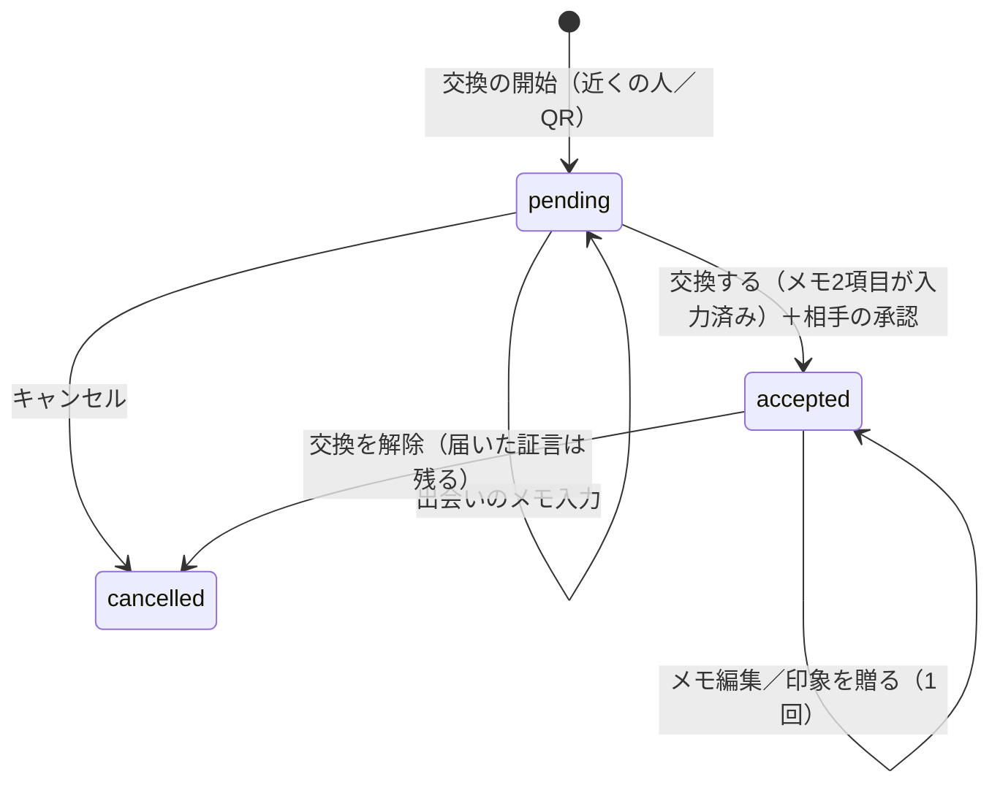
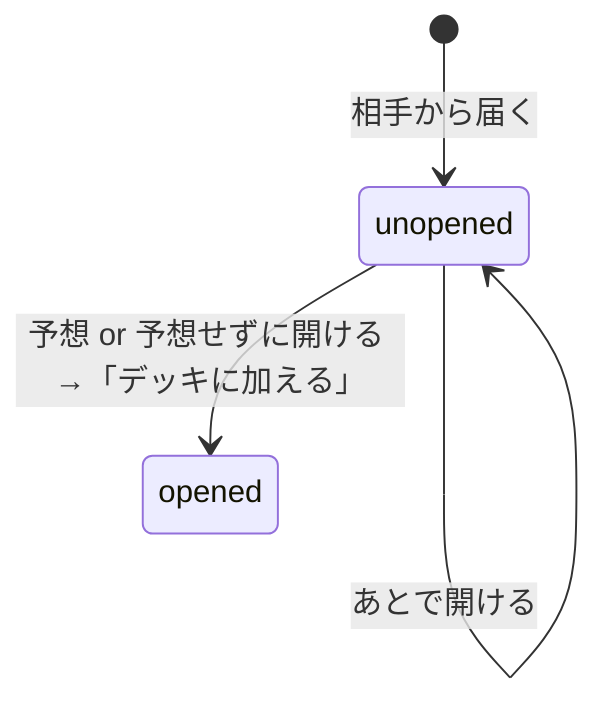
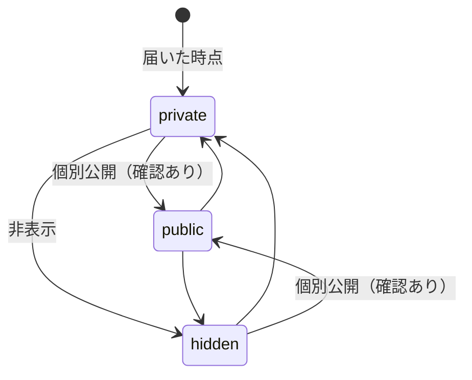
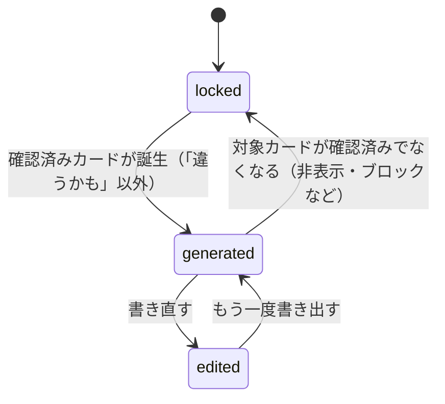
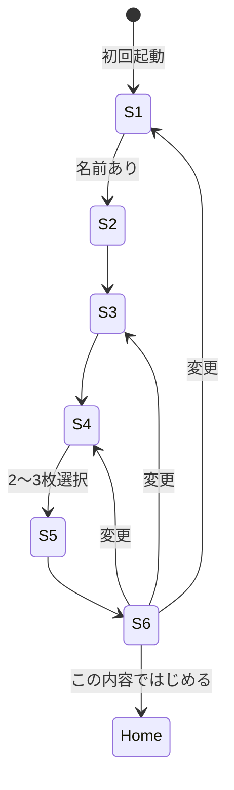

# Flocka v2 画面一覧・状態遷移 仕様書（本実装向け）

- 対象プロトタイプ：`flocka-v2-blue-prototype.html` / `flocka-v2-game.css`
- 作成日：2026-10-13
- 位置づけ：プロトタイプの挙動をそのまま本実装の仕様として書き起こしたもの。プロトタイプ固有のモック処理は「9. モック実装と本実装の差分」にまとめる。

---

## 1. プロダクト概要

仲間と「プレイヤーカード」を交換し、相手から届いた印象・場面のメモ（＝証言）を、開封前に「どの強みカードの証言か」予想してからデッキに加える。同じ強みに **2人以上** の証言がそろうと「確認済みカード」になり、その証言だけを使って自己PRの下書きが生成される。

---

## 2. ナビゲーション構造

### 2.1 タブ

| タブID | ラベル | ルート画面 | バッジ |
|---|---|---|---|
| `find` | デッキ | `deck` | 未開封の封筒数 |
| `exchange` | 交換 | `exchange` | なし |
| `pr` | 自己PR | `pr` | 自己PRが書ける状態のとき「!」 |

- タブごとに独立した画面スタックを持つ（iOS の UINavigationController 相当）。
- 選択中のタブをもう一度押すと、そのタブのスタックをルートに戻す。
- ナビゲーション状態（タブ＋各スタック）は永続化し、再起動時に復元する。復元時、スタック末尾の画面IDが存在しなければ初期状態に戻す。

### 2.2 タブバーを隠す画面（フォーカス画面）

`give` / `memo` / `scan` / `confirm` / `nearby` の5画面では、タブバーを表示しない。登録フロー中もタブバーは非表示。

### 2.3 ナビゲーション操作

| 操作 | 内容 |
|---|---|
| `push(id, params)` | 現在のタブのスタックに積む |
| `replace(id, params)` | スタック末尾を差し替える（交換開始 → 確認画面など） |
| `pop()` | 1つ戻る（ルートでは何もしない） |
| `popTo(id)` | 指定画面まで戻る |
| `goTab(tab, entry?)` | タブを切り替え、そのタブをルートに初期化し、必要なら1画面積む |
| `reset()` | 全タブを初期状態に戻す（登録完了時） |

### 2.4 オーバーレイ

| 種類 | 用途 | 閉じ方 |
|---|---|---|
| シート（下から出るパネル） | 確認ダイアログ・入力フォーム・選択 | 背景タップ／×／Esc。開いた時は最初の操作要素にフォーカス、閉じたら元の要素にフォーカスを戻す |
| 予想チャレンジ | 封筒の開封（全画面ダイアログ） | ×（「あとで開ける」）または「デッキに加える」 |
| トースト（通知） | 操作結果の通知 | 自動で消える（通常 2.6秒、取り消しボタン付きは 5秒）／本文タップで即消える |

トーストは画面下部に表示する。タブバーがある画面ではタブバーの上、ない画面では下部の主ボタンの上に出し、ヘッダーを隠さない。

---

## 3. 画面一覧

| ID | 画面名 | タブ | 遷移元 | タブバー | 目的 |
|---|---|---|---|---|---|
| `onboarding` | 登録フロー（6ステップ） | — | 初回起動 | なし | プロフィールと自己申告カードの作成 |
| `deck` | デッキ（ホーム） | find | タブ | あり | 強みカード一覧と次にやることの提示 |
| `card` | カード詳細 | find | デッキのカード | あり | 証言の確認、新発見への反応 |
| `deco` | カードをデコる | find | カード詳細 | あり | 模様・フレーム・シール・色の設定 |
| `me` | 自分 | find | デッキ左上のアイコン | あり | 自分に関する設定への入口 |
| `avatar` | アイコン | find | 自分 | あり | アイコンの変更 |
| `selfEdit` | プロフィール | find | 自分 | あり | プロフィールと自己申告カードの編集 |
| `pieces` | 届いた証言 | find | 自分 | あり | 届いた証言の一覧 |
| `piece` | 証言 | find | 届いた証言／カード詳細 | あり | 証言の詳細、公開範囲・通報・ブロック・削除依頼 |
| `settings` | 公開範囲・安全 | find | 自分／証言 | あり | 受け取り設定、ブロック・通報の管理 |
| `exchange` | 交換 | exchange | タブ | あり | 自分のプレイヤーカード表示、交換の開始 |
| `connections` | つながった人 | exchange | 交換右上 | あり | 交換相手の一覧と管理 |
| `nearby` | 近くの人と交換 | exchange | 交換 | なし | 近くにいる人から相手を選ぶ |
| `scan` | QRで交換 | exchange | 交換 | なし | QRの表示・読み取り |
| `confirm` | 交換（確認） | exchange | 近くの人／QR／つながった人 | なし | 相手のプレイヤーカード確認、出会いのメモ入力、交換の承認 |
| `give` | 印象を贈る | exchange | 確認／つながった人 | なし | 交換相手へ印象を1つ贈る |
| `memo` | 見た場面をメモで贈る（3ステップ） | exchange | つながった人 | なし | 交換相手へ場面のメモを贈る |
| `pr` | 自己PR | pr | タブ | あり | 自己PR下書きの生成・編集・コピー |
| （オーバーレイ） | 予想チャレンジ | — | デッキ／届いた証言／自己PR | — | 封筒を開封し、カードを予想する |

---

## 4. 画面別仕様

### 4.1 `onboarding` 登録フロー

すべてのステップで、次の共通レイアウトにする。

- **ヘッダー：** 左に戻るボタン（1ステップ目はアプリアイコン）、中央に6分割の進捗バー、右に「n / 6」
- **本文：** 「STEP 0n／ステップ名」→ 見出し → 説明1行 → 入力欄
- **フッター：** 主ボタン1つを画面下に固定

どのステップもスクロールせずに一画面に収める。

| # | ステップ | 入力 | 必須 | 次へ進める条件 | 主ボタン |
|---|---|---|---|---|---|
| 1 | ニックネーム | テキスト（16文字まで） | ○ | 空白を除いて1文字以上 | 次へ（Enterでも進む） |
| 2 | アイコン | 頭文字／イラスト6種／写真、背景色6色 | — | 常に可 | 次へ |
| 3 | ひとこと・関心 | ひとこと（24文字まで）、関心（よく使う12件＋「ほかの関心」シートで残り20件） | — | 常に可 | 次へ |
| 4 | 強みカード | 4カテゴリのタブ × 2列のタイルから選択 | ○ | 2〜3枚選択 | 次へ |
| 5 | しくみ | 選んだカードのプレビュー（自己申告） | — | 常に可 | 内容を確認する |
| 6 | 確認 | 各項目の「変更」で該当ステップへ戻る | — | 常に可 | この内容ではじめる |

- 3枚選んだ時点で、ほかの強みカードは選べなくなる。
- 完了するとプロフィールを保存し、`onboarded = true` にしてナビゲーションを初期化する。トーストは「デッキができた！」。
- 写真は 160×160 の正方形に切り抜き、JPEG（画質80%）に変換して保存する。

### 4.2 `deck` デッキ

- **上部：** 自分のアイコン（→ `me`）、名前、カード枚数、「印象を贈る」リンク
- **おすすめ（1つだけ表示）：** 上から順に条件を判定し、最初に当てはまったものを出す。

  | 優先 | 条件 | 表示 | 遷移 |
  |---|---|---|---|
  | 1 | 未開封の封筒がある | 予想チャレンジ！（封筒n通） | 予想チャレンジ |
  | 2 | 交換済みで、まだ印象を贈っていない相手がいる | 交換した人に印象を贈ろう | `exchange` → `connections` |
  | 3 | 証言が1件もない | まずは交換しよう | `exchange` |

- **カード：** 2列×3段の6枠。足りない枠は「未発見」を表示する。並び順は「確認済み → 新発見 → 証言人数 → 自己申告」。
- **自己PRバー：** 書ける状態なら「自己PRが書けます！」、書けない状態なら「あと証言n人」と進捗メーターを出す。押すと `pr` へ。

### 4.3 予想チャレンジ（オーバーレイ）

1. 封筒を表示し、「◯◯より」と送り主を出す。
2. 3択から予想する。選択肢は「本来のカード＋自分の自己申告カード（不足分は一覧から補う）」で、並び順は証言ごとに固定する。「予想せずに開ける」も選べる。
3. 開封演出に約450msかける（動きを減らす設定の端末では省略）。
4. 結果を表示する。

   | 結果 | 条件 |
   |---|---|
   | 的中！ | 予想が本来のカードと一致 |
   | 予想外！ | 外れたが、本来のカードは自分の自己申告カード |
   | 新発見！ | 外れて、本来のカードは自己申告していないカード |

   あわせて「証言+1」または「2人目の証言で、確認済みに！」を表示する。
5. 「デッキに加える」で開封済みとして保存し、デッキタブへ移る。確認済みになった場合は、トースト「確認済みカード誕生！」に「見る」（→ `pr`）を付ける。

### 4.4 `card` カード詳細

- カードの表示、「このカードをデコる」ボタン、状態の説明
- **新発見カードのみ：** 「納得／保留／違うかも」の反応。「違うかも」を選んだカードは自己PRに使わない。
- **証言一覧：** 各行に送り主、関係、予想結果（的中／外れ／なし）を出す。押すと `piece` へ。

### 4.5 `deco` カードをデコる

- **タブ：** 模様12／フレーム10／シール12／色6
- シールは4枚まで。空いている角に自動で配置し、もう一度押すと外れる。4枚を超えて貼ろうとしたらトーストで知らせる。
- 変更は即時に保存する。「元に戻す」で初期状態に、「完了」で前の画面に戻る。

### 4.6 `exchange` 交換

- **プレイヤーカード：** アイコン、名前、ひとこと、相手に見せる強み（最大3枚。未設定ならデッキの上位3枚）、関心
- 「選ぶ」から見せる強みをシートで選ぶ（3枚まで）。
- **ボタン：** 主ボタン「近くの人と交換」（→ `nearby`）と、副ボタン「QRで交換」（→ `scan`）
- 印象をまだ贈っていない相手がいれば「交換した人に印象を贈る」を表示する。

### 4.7 `nearby` 近くの人と交換

- ブロックしていない近くの人を一覧で出す。交換済みの人には「交換済み・プロフィールを見る」と表示する。
- 選ぶと「交換の開始」（6.1）を行い、`confirm` に置き換える。

### 4.8 `scan` QRで交換

- 上部の切り替えで「自分のQRを見せる」と「相手のQRを読み取る」を行き来する。
- **見せる：** 自分のQR＋アイコン＋名前を表示する。
- **読み取る：** カメラ枠（四隅の目印と、上下に動く読み取りライン）を表示し、読み取れたら「交換の開始」を行って `confirm` へ。

### 4.9 `confirm` 交換（確認）

- 右上に状態チップ「内容確認／交換成立」、中央に相手のプレイヤーカード（スクロールなし。カードの高さが画面に合わせて伸縮する）。
- **出会いのメモ（必須）：** 場所・イベント名（60文字まで）と、交換のきっかけ（100文字まで）。**両方必須。**
  - 交換する前は、確認画面にメモの行を出さない。「交換する」を押すとメモのシートが開き、「保存して交換する」で承認まで進む。
  - 交換が成立したあとは、メモの行を出して編集できる。シートのボタンは「保存する」になる。
- 下部ボタンは状態によって変わる（6.1 参照）。

### 4.10 `give` 印象を贈る

- 冒頭に「交換のきっかけ」（出会いのメモ）を表示する。
- **言葉を選ぶ：** 6つの言葉から1つ選び、理由（140文字まで、必須）を書く。
- **自由に書く：** 8文字以上（140文字まで）。「要約する」でキーワードから短い要約と近い強みカードを提案し、カードは選び直せる。
- 「この印象を贈る」で送信し、完了画面を出す。「あとで」で戻る。
- 1人の相手に贈れる印象は1つまで。

### 4.11 `memo` 見た場面をメモで贈る

| # | ステップ | 入力 | 次へ進める条件 |
|---|---|---|---|
| 1 | 誰に贈る？ | 交換済みでブロックしていない相手から1人 | 選択済み |
| 2 | どの強み？ | 21種類から1つ | 選択済み |
| 3 | 見た場面 | テキスト（80文字まで） | 8文字以上 |

- 「封筒で贈る」で送信し、完了画面「封筒で贈りました」を出す。
- 交換相手がいない場合は、案内文を表示する。

### 4.12 `pr` 自己PR

- **書けない状態：** 「まだ書けません」と、いちばん多いカードの証言数（n/2）を表示する。ボタンは、封筒があれば「封筒を開ける」、なければ「カードを交換する」。
- **書ける状態：** 下書きを1文字ずつ流し込む演出で表示する（タップで全文表示）。右上に文字数、出典に「仲間n人の証言から作成」。
  - 「書き直す」で手で編集できる。編集した内容は保存し、それ以降は自動生成を上書きしない。
  - 「もう一度書き出す」で手編集を破棄して作り直す。
  - 「コピー」はクリップボードに書き込み、失敗したら失敗のトーストを出す。

### 4.13 `piece` 証言

- 本文（印象／場面）、カード、予想結果、場面（出会いのメモの場所）、リンク
- **公開範囲：** 本人だけ／個別公開／非表示（6.4 参照）
- **通報：** 理由を4択から選ぶ → 受付。取り下げできる。
- **ブロック：** 確認してから実行。取り消しできるトーストを出す。
- **削除依頼：** 確認してから依頼。取り消しできる。

### 4.14 その他

| 画面 | 内容 |
|---|---|
| `me` | アイコン（→ `avatar`）、プロフィールと自己申告カード（→ `selfEdit`）、届いた証言（→ `pieces`）、公開範囲・安全（→ `settings`） |
| `avatar` | 種類（頭文字／イラスト／写真）、背景色。写真は端末内にだけ保存する |
| `selfEdit` | 自己申告カード（2〜3枚）、ニックネーム、ひとこと、関心。右上の「保存」は条件を満たすまで押せない。届いた証言は編集できない |
| `pieces` | 新しい順に並べる。未開封の行は予想チャレンジを開き、開封済みの行は `piece` へ |
| `settings` | 受け取り設定3つ（印象／場面のメモ／交換した人からだけ）は確認してから保存。ブロック中の一覧と解除、通報・削除依頼の履歴 |
| `connections` | 状態（承認待ち／贈った印象／関係）、操作（確認／印象を贈る／詳細）、交換の解除（確認あり。届いた証言は消えない） |

---

## 5. データモデル

```text
State {
  schemaVersion: 1
  onboarded: boolean
  profile: { name, role, interests[], avatar{type: initial|motif|photo, color, motif, photo}, links{github} }
  self: CardKey[]                 // 自己申告 2〜3枚
  showcase: CardKey[]             // 交換時に見せる強み（最大3）
  connections: Connection[]
  vibes: Piece[]                  // 届いた印象
  proofs: Piece[]                 // 届いた場面のメモ
  sentVibes[], sentProofs[]       // 贈った記録
  resp: { [CardKey]: agree|hold|disagree }
  deco: { [CardKey]: { pattern, frame, stickers[], color, layout{} } }
  prDraft: string|null            // 手編集した自己PR
  blocked: PeerId[]
  settings: { allowVibe, allowProof, onlyConnected }
  reports[], deletions[]          // { pieceId, reason?, at, withdrawn? }
}
Connection { id, peerId, status: pending|accepted|cancelled, myApproved, exchangedAt,
             context{ place, trigger }, vibe(贈った印象)|null, later }
Piece { id, fromId, card, label|title, text|story, evidence?, opened, guess(CardKey|skip|null),
        guessedAt, visibility: private|public|hidden, createdAt }
```

強みカードは21種類で、4カテゴリに分ける。

| カテゴリ | 枚数 |
|---|---|
| 考える | 6 |
| 動かす | 6 |
| 人と関わる | 6 |
| 自分を育てる | 3 |

---

## 6. 状態遷移

### 6.1 交換（Connection）



- **交換の開始：** 同じ相手と「キャンセル以外」の交換がすでにあれば、新しく作らずにその交換の確認画面を開く。
- **確認画面の下部（状態ごと）：**

  | 状態 | 表示 |
  |---|---|
  | pending・自分は未承認 | 「交換する」＋「キャンセル」 |
  | pending・自分は承認済み | 「相手の承認を待っています…」＋「キャンセル」 |
  | accepted・印象は未送信 | 「印象を贈る」＋「あとで贈る」 |
  | accepted・印象は送信済み | 「交換へ戻る」 |

### 6.2 証言（Piece）



- 「非表示」にした証言と、ブロックした相手からの証言は、デッキの集計・自己PR・一覧から外す。

### 6.3 強みカードの状態（集計ルール）

| 状態 | 条件 | 帯の色 |
|---|---|---|
| 自己申告 | 自分で選んだ、証言0件 | グレー |
| 証言1 | 開封済みの証言が1人分 | ライム |
| 新発見 | 自己申告していない強みで、予想が外れた証言がある | ピンク |
| 確認済み | 開封済みの証言を **異なる2人以上** から受け取っている | 黄 |

デッキには「自己申告」または「証言が1件以上」のカードだけを出す。

### 6.4 公開範囲



公開範囲を変えたら、直前の状態に戻せる「取り消す」付きのトーストを出す。

### 6.5 自己PR



- **対象カード：** デッキの並び順で最初の「確認済みで、反応が『違うかも』でないカード」
- **本文の構成：** 強みの名前 → 証言の引用（最大3件。場面のメモを優先し、場所が分かれば添える）→ 自己申告との関係 → 「（ここに、これから取り組みたいことを書こう）」の空欄
- 仲間の言葉だけで組み立て、経験や成果を補わない。送り主の名前は本文に入れない。

### 6.6 登録



---

## 7. 入力チェック・文字数

| 項目 | ルール |
|---|---|
| ニックネーム | 必須、16文字まで |
| ひとこと | 任意、24文字まで |
| 自己申告カード | 2〜3枚 |
| 相手に見せる強み | 最大3枚 |
| 出会いのメモ | 場所（60文字）・きっかけ（100文字）とも必須 |
| 印象・言葉を選ぶ | 言葉1つ＋理由（必須、140文字まで） |
| 印象・自由に書く | 8〜140文字 |
| 場面のメモ | 8〜80文字 |
| シール | 1カードにつき4枚まで |

---

## 8. 通知・空の状態

| 場面 | 文言 |
|---|---|
| 登録完了 | デッキができた！ |
| 交換成立 | 交換成立！◯◯から封筒が届きました／交換が成立しました |
| 印象を贈った | ◯◯に印象を贈りました |
| メモを贈った | ◯◯に封筒を贈りました |
| 確認済みカード誕生 | 確認済みカード誕生！自己PRが書けます［見る］ |
| つながった人が0人 | まだ交換した人はいません。交換画面から、近くの人やQRで交換できます。 |
| 届いた証言が0件 | まだ届いていません。交換した仲間から印象やメモが届くと、ここに並びます。 |
| 近くに人がいない | 近くに交換できる人がいません。ブロックした人は設定から解除できます。 |

---

## 9. モック実装と本実装の差分（要対応）

| 項目 | プロトタイプ | 本実装で必要なこと |
|---|---|---|
| 交換相手 | 固定の3人（ミナト／ソラ／カエデ） | 近距離通信やサーバーで相手を検出 |
| 相手の承認 | 「交換する」で即成立 | 双方が承認して成立。承認待ちの状態を通知 |
| 相手からの封筒 | 交換が成立すると、決まった印象が1通届く | 相手が実際に贈った印象・メモをサーバー経由で受信 |
| QR | 名前をもとに描いた飾りのコードで、約2秒後に自動で読み取ったことにする | 本物のQRの生成（期限付きトークン推奨）とカメラでの読み取り |
| 受け取り設定 | 「印象を受け取る」以外の2つは保存のみで、動きに反映されない | 受信時のフィルタとして実装 |
| 通報・削除依頼 | 端末内で記録するだけ | 運営への送信と対応状況の同期 |
| 保存先 | 端末内（localStorage）。写真も端末内 | アカウントに紐づけてサーバーに保存。写真の保存方針と同意 |
| 要約 | 端末内のキーワード照合 | 方針を決める（AIを使うかどうか、原文を併記するか） |
| 読み込み方式 | React／Babel の開発用版を外部サイトから読み込む | 書き出し済みの部品に置き換える |
| `?embed=` | 紹介資料用にサンプルデータで1画面だけを表示する | 本実装では不要 |
